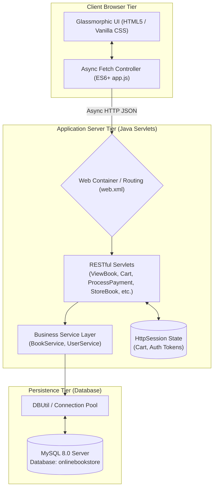
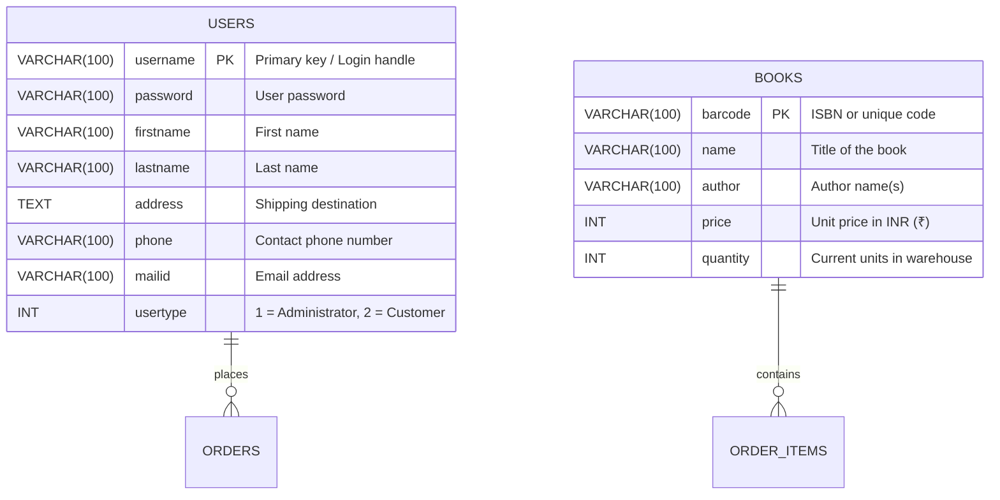

<div align="center">

# 📚 Asthana Bookstore Modern
### *A Next-Generation Full-Stack Java E-Commerce Platform & Digital Bookstore*

[](https://github.com)
[](https://www.oracle.com/java/)
[](https://www.mysql.com/)
[](https://tomcat.apache.org/)
[](https://maven.apache.org/)
[](https://developer.mozilla.org/en-US/docs/Web/CSS)
[](#quick-start)

---

[✨ Overview](#-overview) •
[🏛️ Architecture](#-system-architecture) •
[🎨 UI & Experience](#-visual-interface-overview) •
[📊 Database Schema](#-database-schema) •
[🚀 Quick Start](#-quick-start) •
[🔑 Demo Accounts](#-test-credentials) •
[📡 API Reference](#-restful-api-endpoints) •
[👤 Creator](#-project-ownership)

---

</div>

## 🌟 Overview

**Asthana Bookstore Modern** is an enterprise-grade digital bookstore and inventory platform built by **Aditya Asthana**. Designed to bridge classic enterprise Java stability with 2026 consumer web standards, it eliminates cumbersome frameworks in favor of high-throughput asynchronous Java Servlets, direct JDBC persistence, and a modern glassmorphic interface.

> [!TIP]
> **Zero Heavy Framework Bloat**: Starts in under 2 seconds with embedded Tomcat (`webapp-runner.jar`). No complex Spring Boot or node runtime required!

### ✨ Highlights at a Glance
- ⚡ **Asynchronous REST Servlets**: Blazing-fast JSON APIs powered by Google Gson.
- 💎 **Glassmorphic Obsidian Design**: Ultra-sleek dark palette with backdrop blur and fluid CSS animations.
- 🛒 **Slide-Over Cart Drawer**: Real-time session-synchronized bag with instantaneous subtotal calculation.
- 🧾 **Official Tax Invoice Generator**: Generates print-ready itemized digital invoices upon checkout.
- 📊 **Real-Time Admin KPI Analytics**: Live metrics for Total Titles, Total Units, Inventory Worth (₹), and Low Stock Alerts.
- ⚡ **One-Click Restocking**: Instant `+5 Restock` capability directly from the inventory table.
- 🔍 **Real-Time Instant Search**: Fast client-side filtering by book title, author, and ISBN barcode.

---

## 🏛️ System Architecture

The project adheres to a clean **Model-View-Controller (MVC)** architectural blueprint with complete separation of concerns:



---

## 🎨 Visual Interface Overview

```
+----------------------------------------------------------------------------------------------------+
|  📚 ASTHANA BOOKSTORE                     [ Home ] [ Catalog ] [ About ] [ 🛒 Cart (3) ] [ Sign In ]|
+----------------------------------------------------------------------------------------------------+
|                                                                                                    |
|    ✨ Next-Gen Web Platform • Engineered by Aditya Asthana                                         |
|    Curated Knowledge for the Next Generation of Builders.                                          |
|                                                                                                    |
|    [ 12+ Titles ]          [ 100% ACID DB ]          [ < 100ms Latency ]          [ 4.9 ★ Rating ] |
|                                                                                                    |
+----------------------------------------------------------------------------------------------------+
|  🔍 [ Search by title, author, or ISBN... ]   [ All ] [ Java ] [ Rust ] [ Python ] [ Architecture ] |
+----------------------------------------------------------------------------------------------------+
|   +-----------------------+   +-----------------------+   +-----------------------+                |
|   | ☕ Java Core           |   | 🦀 Systems            |   | 🐍 Python             |                |
|   | Effective Java        |   | The Rust Book         |   | Fluent Python         |                |
|   | Joshua Bloch          |   | Steve Klabnik         |   | Luciano Ramalho       |                |
|   | ₹ 368    [24 in stock]|   | ₹ 560    [18 in stock]|   | ₹ 1,014   [8 in stock]|                |
|   | [-] [ 1 ] [+] [Add]   |   | [-] [ 1 ] [+] [Add]   |   | [-] [ 1 ] [+] [Add]   |                |
|   +-----------------------+   +-----------------------+   +-----------------------+                |
+----------------------------------------------------------------------------------------------------+
```

### 1. Storefront (`index.html`)
- Ambient dark mesh background with multi-tier blurred glass navigation pill.
- Live public catalog exploration with category tags (Java, Rust, Python, Web, Architecture).
- Creator spotlight highlighting full-stack engineering milestones.

### 2. Customer Lounge (`customer_dashboard.html`)
- Interactive book cards with genre-color-coded cover art and real-time stock status pills (`In Stock`, `Low Stock`, `Out of Stock`).
- Slide-over shopping bag drawer that supports item increments, decrements, and removals.
- Checkout flow simulating Card, UPI / QR, and Net Banking payments.
- Printable Official Tax Invoice modal displaying order timestamp, invoice ID, and itemized totals.

### 3. Administrator Console (`admin_dashboard.html`)
- Real-time KPI Metric tiles tracking catalog counts, valuation, and critical stock thresholds.
- Inventory search & status filter (`In Stock`, `Low Stock`, `Sold Out`).
- Built-in ISBN / Barcode Generator for seamless new book additions.
- Rapid `+5 Restock` shortcut and safe delete confirmation modals.

---

## 📊 Database Schema



---

## 🚀 Quick Start

### 📋 Prerequisites
- **Java Development Kit (JDK)**: 8 or higher (OpenJDK 8, 17, 21, or 26)
- **Apache Maven**: 3.8+
- **MySQL Server**: 8.0+

---

### Step 1: Database Initialization
Open MySQL Command Line or Workbench, log in as root, and execute:

```sql
CREATE DATABASE IF NOT EXISTS onlinebookstore;
USE onlinebookstore;

-- 1. Create Books Table
CREATE TABLE IF NOT EXISTS books (
    barcode VARCHAR(100) PRIMARY KEY,
    name VARCHAR(100),
    author VARCHAR(100),
    price INT,
    quantity INT
);

-- 2. Create Users Table
CREATE TABLE IF NOT EXISTS users (
    username VARCHAR(100) PRIMARY KEY,
    password VARCHAR(100),
    firstname VARCHAR(100),
    lastname VARCHAR(100),
    address TEXT,
    phone VARCHAR(100),
    mailid VARCHAR(100),
    usertype INT
);

-- 3. Populate Standard Catalog
INSERT INTO books VALUES('9780134190563','The Go Programming Language','Alan A. A. Donovan & Brian W. Kernighan',400,12);
INSERT INTO books VALUES('9780133053036','C++ Primer','Stanley Lippman, Josée Lajoie & Barbara Moo',976,15);
INSERT INTO books VALUES('9781718500457','The Rust Programming Language','Steve Klabnik & Carol Nichols',560,18);
INSERT INTO books VALUES('9781491910740','Head First Java','Kathy Sierra, Bert Bates & Trisha Gee',754,25);
INSERT INTO books VALUES('9781492056300','Fluent Python','Luciano Ramalho',1014,8);
INSERT INTO books VALUES('9781720043997','The Road to Learn React','Robin Wieruch',239,20);
INSERT INTO books VALUES('9780132350884','Clean Code: Agile Software Craftsmanship','Robert C. Martin',288,6);
INSERT INTO books VALUES('9780132181273','Domain-Driven Design','Eric Evans',560,30);
INSERT INTO books VALUES('9781951204006','A Programmer\'s Guide to Computer Science','William Springer',188,10);
INSERT INTO books VALUES('9780316204552','The Soul of a New Machine','Tracy Kidder',293,32);
INSERT INTO books VALUES('9780132778046','Effective Java','Joshua Bloch',368,24);
INSERT INTO books VALUES('9781484255995','Practical Rust Projects','Shing Lyu',257,15);

-- 4. Create Default Verified Accounts
INSERT INTO users VALUES('aditya','password123','Aditya','Asthana','India','9876543210','aditya.asthana@example.com',2);
INSERT INTO users VALUES('Admin','Admin','Mr.','Admin','Global HQ','9584552224521','admin@example.com',1);
INSERT INTO users VALUES('demo','demo','Demo','User','Demo City','42502216225','demo@example.com',2);

COMMIT;
```

---

### Step 2: Configure Database Credentials
Verify or update `src/main/resources/application.properties`:

```properties
db.driver=com.mysql.cj.jdbc.Driver
db.host=jdbc:mysql://localhost
db.port=3306
db.name=onlinebookstore
db.username=root
db.password=YOUR_MYSQL_PASSWORD
```

---

### Step 3: Compile and Launch

Open PowerShell or Command Prompt in the project directory:

```powershell
# 1. Package WAR & copy embedded Tomcat runner
mvn clean package

# 2. Start the embedded server on port 8083
java -jar target/dependency/webapp-runner.jar --port 8083 target/onlinebookstore-modern.war
```

Access the application in your browser:  
🔗 **`http://localhost:8083/`**

---

## 🔑 Test Credentials

| Role | Username | Password | Access Capabilities |
| :--- | :--- | :--- | :--- |
| **👤 Customer (Owner)** | `aditya` | `password123` | Browse catalog, bag management, checkout, printable tax invoice |
| **👤 Customer (Demo)** | `demo` | `demo` | Guest & demo test account |
| **🛡️ Administrator** | `Admin` | `Admin` | Real-time KPI analytics, add/edit/delete books, quick restock |

> [!NOTE]
> On the sign-in page (`login.html`), you can use the **1-Click Quick Demo Fill** buttons to instantly fill and sign into either role!

---

## 📡 RESTful API Endpoints

All endpoints communicate via JSON using standard HTTP status codes:

| Endpoint | Method | Role | Description |
| :--- | :--- | :--- | :--- |
| `/viewbook` | `GET` | Public / Customer | Returns available books list with stock levels |
| `/storebooks` | `GET` | Administrator | Returns complete inventory data for management |
| `/cart` | `GET` | Customer | Fetches session cart items, quantities, and subtotal |
| `/cart` | `POST` | Customer | Adds, increments, or decrements items in the cart |
| `/pay` | `POST` | Customer | Finalizes payment, decrements warehouse stock, returns order receipt |
| `/addbook` | `POST` | Administrator | Adds a new book to the catalog |
| `/updatebook` | `POST` | Administrator | Updates existing book title, author, price, or stock |
| `/removebook` | `POST` | Administrator | Deletes a book from the inventory |
| `/userlog` | `POST` | Public | Customer session authentication |
| `/adminlog` | `POST` | Public | Administrator session authentication |
| `/userreg` | `POST` | Public | Registers a new customer account |
| `/logout` | `GET` | Authenticated | Terminates session and invalidates state |

---

## 📂 Project Directory Structure

```plaintext
onlinebookstore-modern/
├── WebContent/                         # Presentation Layer
│   ├── css/
│   │   └── styles.css                  # Modern Glassmorphic Design System
│   ├── js/
│   │   └── app.js                      # Toast Engine, Cart Drawer, Fetch Helpers
│   ├── WEB-INF/
│   │   └── web.xml                     # Servlet & Filter Deployment Descriptor
│   ├── index.html                      # Storefront & Catalog Landing Page
│   ├── login.html                      # Dual-Role Authentication
│   ├── register.html                   # Customer Registration
│   ├── customer_dashboard.html         # Customer Lounge & Interactive Checkout
│   ├── admin_dashboard.html            # Admin Analytics & Inventory Console
│   └── about.html                      # Project & Architecture Showcase
├── src/main/java/                      # Application Layer
│   ├── com/bittercode/
│   │   ├── constant/                   # System Constants & Error Enums
│   │   ├── model/                      # POJO Domain Entities (Book, User, Cart)
│   │   ├── service/                    # Business Logic Interfaces & Impls
│   │   └── util/                       # JDBC Connection & Session Helpers
│   └── servlets/                       # Asynchronous HTTP Servlets
├── src/main/resources/
│   └── application.properties          # Database Configuration
├── pom.xml                             # Maven POM & Tomcat Webapp-Runner Config
└── README.md                           # Documentation
```

---

## 👤 Project Ownership

- **Author & Architect**: **Aditya Asthana**
- **Repository**: [onlinebookstore-modern](file:///c:/Users/Aditya%20Asthana/Desktop/Aditya/onlinebookstore-modern)
- **Year**: 2026

*Crafted with precision, high visual fidelity, and clean code principles by **Aditya Asthana**.*
